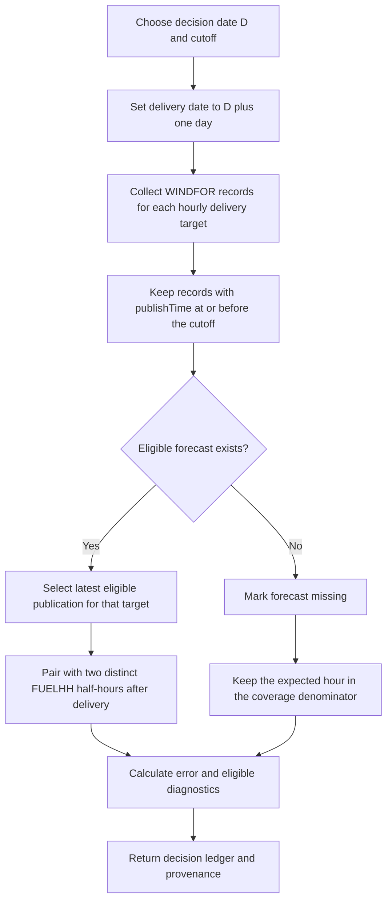
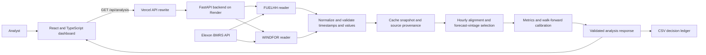
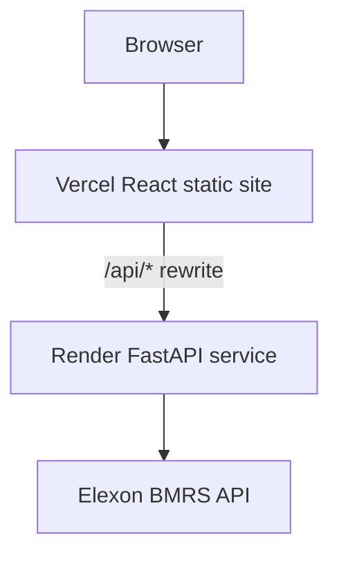
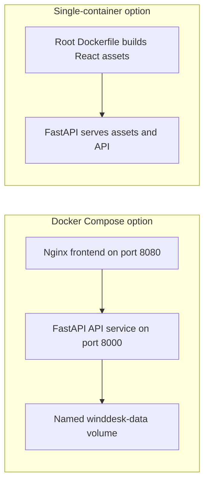

# WindDesk

**A decision-time audit desk for UK day-ahead wind forecasts.** WindDesk reconstructs which Elexon wind forecast vintage was available at a selected decision cutoff, compares it with the eventual wind outturn, and exposes forecast error, uncertainty and data coverage in an auditable workflow.

> **Pilot scope:** decision support and forecast evaluation only. WindDesk does not calculate the utility's total procurement requirement or recommend trades. Demand, market prices, thermal availability and portfolio data are outside the scope of this assignment.

<p align="left">
  <a href="https://w8k3q2m9.vercel.app/">Live application</a> ·
  <a href="https://w8k3q2m9.onrender.com/api/health">Backend health</a> ·
  <a href="https://github.com/Surya270106/w8k3q2m9">Source repository</a>
</p>

## Project status

| Area | Status |
|---|---|
| Public source | [GitHub repository](https://github.com/Surya270106/w8k3q2m9) |
| Frontend | [Vercel deployment](https://w8k3q2m9.vercel.app/) |
| Backend | [Render service](https://w8k3q2m9.onrender.com/) |
| Previously reported backend verification | 53 tests passed, 0 failed, 0 skipped; one upstream Starlette/AnyIO deprecation warning |
| Frontend verification | TypeScript check and Vite production build passed in the reported local run |
| Previously verified Elexon sample | 744/744 hourly intervals matched; 1,488/1,488 source half-hour readings; live source reported in the local integration run on 26 October 2026 |
| Docker runtime | Dockerfiles and Compose configuration are included; container execution has not been verified in the available environment |
| Full browser QA | Core navigation, decision controls, demo toggle, refresh, daily chart selections and methodology panel were exercised manually. CSV contents, keyboard accessibility, responsive layouts and all error states have not been fully verified. |
| Submission video and form | Not completed at the time this README was prepared |

The live URLs above are the intended public entry points. Live data availability can change; always inspect the source-state label in the application rather than assuming a successful page load means the latest request fetched fresh Elexon data.

## Why this project is interesting

The challenge is not just plotting a forecast. It is reconstructing the information set that existed when a historical decision was made, preserving forecast publication vintages, aligning datasets with different resolutions, and measuring uncertainty without allowing future outcomes to leak into earlier decisions.

WindDesk emphasizes:

- **Decision-time replay:** choose a historical decision date and cutoff, then select only forecasts published by that cutoff.
- **Resolution-aware evaluation:** compare hourly WINDFOR targets to an hourly actual formed from two distinct half-hour FUELHH WIND readings.
- **Walk-forward calibration:** estimate empirical error ranges and a positive over-forecast buffer using only fully completed prior delivery days.
- **Data quality as a first-class result:** show expected periods, matched periods, missing readings and source status rather than silently dropping gaps.
- **Traceability:** retain publication timestamps, actual components, run identifiers, source status and a data fingerprint.

## Product scope and assumptions

- **Decision dates:** 1-31 January 2026.
- **Delivery dates:** 2 January-1 February 2026, one day after each decision date.
- **Default decision cutoff:** 09:00 in `Europe/London` on the decision date. This is a configurable assignment assumption, not a claim about a market gate-closure deadline.
- **Actuals:** Elexon `FUELHH`, filtered to `fuelType == "WIND"`.
- **Forecasts:** Elexon `WINDFOR` stream records, preserving `startTime` and `publishTime` separately.
- **Source resolution:** WINDFOR delivery targets are hourly; FUELHH actuals are half-hourly.
- **Evaluation resolution:** one hour. The actual for an hour is the arithmetic mean of the two distinct constituent half-hour MW values. If either half-hour is missing or invalid, the hourly actual remains missing.
- **Expected January sample:** 31 delivery days x 24 hours = 744 hourly periods, supported by 1,488 half-hour FUELHH inputs when complete.
- **Historical warm-up:** earlier delivery days are fetched to establish the initial calibration history. They are not included in the January headline evaluation metrics.

### Decision-time forecast selection



`startTime` identifies the delivery target. `publishTime` identifies the forecast vintage. A forecast published after the selected cutoff must never be selected for that decision.

### End-to-end architecture



### Deployment topology

The current public setup uses Vercel for the frontend and Render for the Python API. The Vercel rewrite forwards `/api/*` requests to the Render service so the browser can use same-origin API paths.



The repository also includes two Docker deployment options. They are alternatives to the hosted split topology, not the same deployment:



Docker configuration is included, but a Docker image build and container runtime test have not been verified in the available environment.

## Features

- Historical forecast-vintage selection at a configurable decision cutoff.
- Forecast-versus-actual time-series view for a selected delivery day.
- MAE, RMSE, signed bias, WAPE, MAPE eligibility, P90/P95 absolute error and over-forecast frequency.
- Daily error diagnostics, hour-of-day diagnostics, forecast-lead-time diagnostics and signed-error distribution.
- Empirical walk-forward uncertainty interval and positive over-forecast buffer, with calibration sample size and sufficiency warning.
- Coverage accounting for expected hours, forecast availability, paired actual availability and underlying half-hour inputs.
- Hourly decision ledger that includes each half-hour actual, the hourly mean, selected publication time, forecast lead and error.
- CSV export, source status, warnings, run ID and reproducible data fingerprint.
- Explicit live, cached/stale and synthetic demo states. Synthetic data is for a walkthrough only and must not be interpreted as Elexon observations.

## Metrics and calibration

Let `forecast` be the selected forecast and `actual` the matched hourly mean of the two half-hour FUELHH readings. The error convention is:

`error = forecast - actual`

Therefore positive bias indicates that wind was over-forecast on average.

| Metric | Meaning |
|---|---|
| MAE | Mean absolute forecast error, in MW |
| RMSE | Square root of mean squared error, in MW; penalizes larger misses more strongly |
| Bias | Mean signed error, in MW |
| WAPE | Sum of absolute errors divided by sum of actual generation |
| MAPE | Mean absolute percentage error, included only for periods where actual generation is at least 100 MW |
| P90/P95 absolute error | Retrospective 90th/95th percentile of absolute errors |
| P90 positive over-forecast buffer | P90 quantile of `max(forecast - actual, 0)` using eligible prior calibration errors |
| Interval coverage | Share of evaluation outcomes inside the empirical interval; realized coverage can differ from its nominal level |

### Leakage controls

For a decision on day `D`, calibration may use only errors from fully completed delivery days strictly earlier than `D`. The current delivery day's outcomes and future delivery days cannot calibrate that decision. The implementation uses a trailing calibration window and requires a minimum number of complete days; an incomplete day does not count toward that minimum.

The signed-error interval and positive over-forecast buffer are empirical historical summaries, not guarantees. The positive over-forecast buffer is not a procurement quantity, reserve requirement or trading instruction. Total procurement also depends on demand, other generation, plant availability and market prices, which are intentionally outside this dataset scope.

## Data sources

- [Elexon FUELHH stream documentation](https://bmrs.elexon.co.uk/api-documentation/endpoint/datasets/FUELHH/stream) - half-hourly generation outturn by fuel type.
- [Elexon WINDFOR stream documentation](https://bmrs.elexon.co.uk/api-documentation/endpoint/datasets/WINDFOR/stream) - wind generation forecasts and publication vintages.
- [Elexon OpenAPI schema](https://data.elexon.co.uk/swagger/v1/swagger.json) - API contract reference.
- [REint](https://reint.ai/) - product context for forecast-led energy decision tools. This project is an independent assignment pilot and is not affiliated with REint.

No demand, market-price, thermal generation, or external weather datasets are used for the analysis.

## Repository layout

```text
.
|-- .dockerignore                    # Excludes build artifacts and local files from Docker context
|-- .env.example                     # Non-secret runtime configuration defaults
|-- .github/workflows/ci.yml         # Backend test and frontend build workflow
|-- .gitignore                       # Excludes local environments, dependencies and caches
|-- Dockerfile                       # Multi-stage single-container build
|-- docker-compose.yml               # Nginx frontend and FastAPI backend services
|-- heroku.yml                       # Heroku container build/run configuration
|-- vercel.json                      # Root Vercel build/output and API rewrite configuration
|-- package.json                     # Root npm workspace and build scripts
|-- package-lock.json                # Locked npm dependency graph
|-- requirements.txt                 # Root Python dependencies and pytest
|-- pytest.ini                       # Pytest configuration
|-- README.md                        # Project overview and developer guide
|-- SUBMISSION_CHECKLIST.md          # Release gates and current status
|-- backend/
|   |-- Dockerfile                   # Standalone API container
|   |-- requirements.txt             # Pinned API dependencies
|   |-- app/
|   |   |-- __init__.py              # Backend package marker
|   |   `-- main.py                  # Elexon ingestion, normalization, analysis and FastAPI routes
|   `-- tests/
|       `-- test_analysis.py         # Deterministic numerical, cutoff and API regressions
|-- docs/
|   |-- architecture.md              # Design decisions and data flow
|   |-- demo-script.md               # Customer pitch and technical walkthrough run sheet
|   |-- deployment-runbook.md        # Deployment and post-deployment verification steps
|   |-- research-notes.md             # Domain and open-source research notes
|   `-- evidence/
|       |-- elexon-january-resolution-audit.json
|       `-- elexon-resolution-samples.json
`-- frontend/
    |-- Dockerfile                   # Standalone Nginx frontend container
    |-- index.html                   # Vite HTML entry point
    |-- nginx.conf                   # Static serving and API proxy for Compose
    |-- package.json                 # React, TypeScript, Recharts and frontend scripts
    |-- tsconfig.json                # TypeScript project configuration
    |-- vercel.json                  # Vercel API rewrite when frontend is deployed as its own root
    |-- vite.config.ts               # Vite config and local API proxy
    `-- src/
        |-- App.tsx                  # Dashboard and interactions
        |-- main.tsx                 # React entry point
        |-- styles.css               # Dashboard styles
        `-- vite-env.d.ts            # Vite type declarations
```

## Run locally

### Requirements

- Python 3.12.
- Node.js 22 and npm.
- Docker Engine and Docker Compose are optional for container-based runs.

### Option A: Docker Compose

From the repository root:

```bash
docker compose up --build
```

Open `http://localhost:8080`. Nginx serves the frontend and proxies `/api/*` to the API service. The Compose configuration uses the `winddesk-data` volume for source snapshots.

### Option B: Single-container Docker image

From the repository root:

```bash
docker build -t winddesk:local .
docker run --rm -p 8000:8000 -e ALLOW_DEMO_FALLBACK=true winddesk:local
```

Open `http://localhost:8000`. FastAPI serves the built frontend and API. The local filesystem cache is not durable unless a persistent volume is mounted.

### Option C: Local development without Docker

Install Python dependencies from the repository root:

```powershell
py -3.12 -m venv .venv
.\.venv\Scripts\Activate.ps1
python -m pip install -r requirements.txt
```

Start the backend in terminal 1:

```powershell
cd backend
python -m uvicorn app.main:app --reload --port 8000
```

Start the frontend in terminal 2, from the repository root:

```powershell
npm ci
npm run dev --workspace frontend
```

Open `http://localhost:5173`. Vite proxies `/api/*` to `http://127.0.0.1:8000` by default.

For Linux/macOS, use `python3.12 -m venv .venv`, activate with `source .venv/bin/activate`, and use the same pip/npm commands. Run the backend command from the `backend` directory.

## Tests and build

From the repository root, with Python and Node dependencies installed:

```bash
python -m pytest -q
npm ci
npm run build
```

The frontend build runs the TypeScript project check and Vite production build. The previously reported build emitted a bundle-size advisory for a 595.24 kB minified main JavaScript chunk (168.41 kB gzip). This warning was documented rather than addressed with an unverified code split.

The previously reported local backend suite passed 53 tests with no failures or skips and one upstream Starlette/AnyIO deprecation warning. Results can vary with later code changes; rerun the commands above before submitting.

## API endpoints

| Method and path | Purpose |
|---|---|
| `GET /api/health` | Liveness check; does not prove Elexon is reachable |
| `GET /api/ready` | Application readiness check |
| `GET /api/meta` | Evaluation scope and source metadata |
| `GET /api/analysis?month=2026-01&cutoff=09:00` | Validated analysis response; supports the documented refresh/demo options |
| `GET /docs` | FastAPI OpenAPI documentation on the Render service |

Try the deployed analysis endpoint at [Vercel API analysis](https://w8k3q2m9.vercel.app/api/analysis?month=2026-01&cutoff=09%3A00) or [Render API analysis](https://w8k3q2m9.onrender.com/api/analysis?month=2026-01&cutoff=09%3A00). Inspect the returned source status before interpreting the values.

## Configuration

The provided `.env.example` lists the runtime options. Configure values in the host environment; never commit secrets or local `.env` files.

| Variable | Purpose | Default from the example |
|---|---|---|
| `ELEXON_API_BASE` | Elexon BMRS API base URL | `https://data.elexon.co.uk/bmrs/api/v1` |
| `ALLOW_DEMO_FALLBACK` | Permit a clearly labelled synthetic fallback if live fetch fails and no snapshot exists | `true` |
| `CACHE_TTL_SECONDS` | Cache freshness in seconds | `900` |
| `DATA_DIR` | Directory for cached snapshots | `data` |
| `CALIBRATION_WARMUP_DAYS` | Historical warm-up period | `14` |
| `CALIBRATION_WINDOW_DAYS` | Trailing calibration window | `14` |
| `MIN_CALIBRATION_DAYS` | Minimum complete delivery days for calibration | `5` |
| `CORS_ORIGINS` | Allowed origins for direct cross-origin API calls | Local Vite origins |

The deployed Vercel frontend uses a rewrite for `/api/*` to reach the Render backend. The frontend's code uses relative `/api` requests by default.

## Deployment

### Current hosted setup

- **Frontend:** [https://w8k3q2m9.vercel.app/](https://w8k3q2m9.vercel.app/)
- **Backend:** [https://w8k3q2m9.onrender.com/](https://w8k3q2m9.onrender.com/)
- **Vercel configuration:** root `vercel.json` builds the frontend workspace to `frontend/dist` and rewrites `/api/*` to the Render service. `frontend/vercel.json` supports an independent frontend-root deployment.

The health endpoint is a liveness check. Validate `/api/analysis` and inspect the `source` field to distinguish live, cached/stale and synthetic data.

### Container deployment options

The root `Dockerfile` builds the React bundle and runs FastAPI in one container. `docker-compose.yml` instead runs separate API and Nginx services. The repository also includes a `heroku.yml` for a single-container Heroku path. These configurations are provided, but Docker runtime verification was not completed in the environment used for the reported checks.

On platforms with ephemeral filesystems, cached snapshots may be lost after restart or redeployment. Use persistent storage or external object storage before relying on caching as durable infrastructure.

## Known limitations

- This is a historical forecasting analysis pilot, not a complete procurement optimizer or trading system.
- Evaluation is restricted to national wind forecast and wind outturn data from Elexon.
- WINDFOR is hourly; actuals are half-hourly and the comparison uses the mean of two complete half-hour readings.
- Forecast uncertainty is empirical. Its interval coverage is not guaranteed to match the nominal rate in future data.
- The calibration window is pooled and not conditioned by hour of day or lead-time bucket; lead-time charts are diagnostics, not a conditional probabilistic model.
- Live API availability and source completeness can change. Coverage and source status must be checked on every run.
- Docker build/runtime, full browser responsive/accessibility checks, and saved CSV content inspection were not verified as part of the last reported verification pass.
- The Vite bundle-size advisory remains. It has not been hidden with an unverified optimization.

## AI-tool disclosure

AI tools assisted with development and review. **Codex** was used for implementation refinement, testing and documentation; **Claude** was also used during earlier project work. The API contracts and sampled records were checked against Elexon documentation and source responses. All reported verification claims are tied to the specific local run described above and are not a guarantee of future service availability.

## Further reading

- [Elexon FUELHH stream documentation](https://bmrs.elexon.co.uk/api-documentation/endpoint/datasets/FUELHH/stream)
- [Elexon WINDFOR stream documentation](https://bmrs.elexon.co.uk/api-documentation/endpoint/datasets/WINDFOR/stream)
- [Elexon OpenAPI schema](https://data.elexon.co.uk/swagger/v1/swagger.json)
- [REint](https://reint.ai/)
- [Prognosebuch](https://github.com/tojacob03/Prognosebuch) - immutable forecast vintages and transparent backtests
- [Timescale forecast-store](https://github.com/timescale/forecast-store) - forecast data storage and benchmarking patterns
- [Energy price forecasting and risk validation](https://github.com/soentkeblindow/energy-price-forecast-risk-validation) - chronological evaluation patterns
